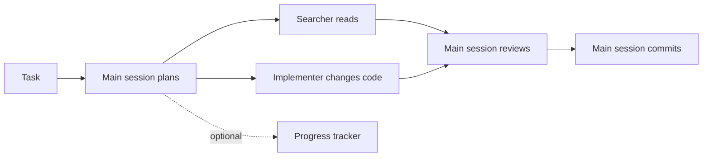

# Build Crew

A Claude Code plugin where the main session leads and reviews the work. A read-only searcher finds code and conventions; an implementer handles scoped coding tasks. An optional progress tracker shows the plan and helper activity.

[](.claude-plugin/plugin.json)
[](LICENSE)

## How it works

| Component | What it does | Model |
|---|---|---|
| Main session | Plans, makes architecture and security decisions, reviews helper work, and handles commits | Your selected model |
| `build-crew:searcher` | Finds files, callers, and conventions. It cannot edit files. | `haiku` |
| `build-crew:implementer` | Implements a scoped task and runs relevant tests. It does not commit. | `sonnet` |
| `build-crew:progress-tracker` | Creates and updates a live project tracker when Claude's artifact tools are available | Main session |

The SessionStart hook adds the working rules from `context/working-model.md` to each Claude Code session. You do not need to copy them into your project's `CLAUDE.md`.



## Install

Build Crew runs in Claude Code. Add this repository as a marketplace, then install the plugin:

```text
/plugin marketplace add kishikai/buildcrew
```

```text
/plugin install build-crew@build-crew
```

To load a local checkout while developing the plugin, run Claude Code from the parent directory:

```text
claude --plugin-dir ./buildcrew
```

For cloud sessions on claude.ai/code, add these commands to the environment setup script:

```bash
claude plugin marketplace add kishikai/buildcrew
claude plugin install build-crew@build-crew --scope user
```

Claude Code runs plugin hooks and helper tools with your account's permissions. The session hook reads the plugin's working-model file. The implementer can edit files and run shell commands, so review the instructions and agent definitions before installing.

## Use it

Describe the work to the main session. Once the plan is clear, ask it to delegate a code lookup to the searcher or a well-defined implementation task to the implementer. The main session reviews each result before using it.

Examples:

- `Have the searcher find every caller of save_message and report the tests that cover them.`
- `Have the implementer add pagination to the activity list using the existing API pattern. Run the relevant tests and report what changed.`

To create a tracker, ask `Set up a progress tracker for this project.` The skill asks whether to label steps as sprints, milestones, or phases, then creates a page and updates it as work moves forward. The tracker URL is stored in `.claude/build-tracker.json`; commit that file if you want other sessions to reuse the page.

The tracker is a claude.ai artifact. It needs Claude Code signed in with a claude.ai account and the artifact tools enabled. The searcher and implementer work without it. A tracker page stays private until you share it from its Share menu.

## Configure it

- Change the model aliases in `agents/searcher.md` and `agents/implementer.md`.
- Edit `context/working-model.md` to change the rules loaded at session start.
- Edit `skills/progress-tracker/template/index.html` to change the tracker layout.
- `skills/progress-tracker/render.py` renders the page as the JSON document sent to the artifact tools.

## Repository layout

```text
.claude-plugin/              Plugin and marketplace manifests
agents/                      Read-only searcher and implementation helper
context/working-model.md     Rules added to each session
hooks/hooks.json             SessionStart hook
skills/progress-tracker/      Tracker instructions, renderer, and page template
```

See [CONTRIBUTORS.md](CONTRIBUTORS.md) to contribute. Build Crew is released under the [MIT License](LICENSE). Created and maintained by [kishikai](https://github.com/kishikai).

## Acknowledgements

The README was edited with [humanizer](https://github.com/blader/humanizer). Its attribution and MIT notice are in [THIRD_PARTY_NOTICES.md](THIRD_PARTY_NOTICES.md).
